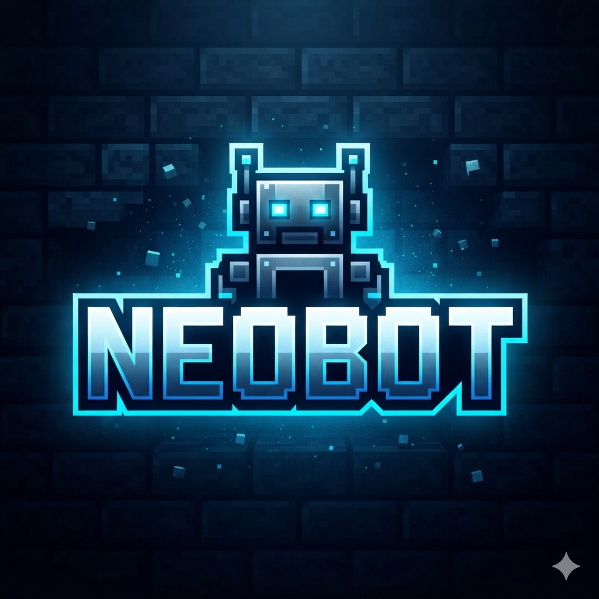

<div align="center">
  

  <h1>NeoBot</h1>

  <p><strong>A Mineflayer-based anti-AFK bot that keeps a Minecraft server alive — self-hostable, open-source, one-click deployable.</strong></p>

  <p>
    <a href="https://github.com/ashfaqizop/neobot/actions/workflows/ci.yml"></a>
    
    
    
  </p>

  <p>
    <a href="https://render.com/deploy?repo=https://github.com/ashfaqizop/neobot"></a>
  </p>
</div>

---

NeoBot connects a single Mineflayer bot to a single Minecraft server and keeps
both that server **and its own free-tier host** awake indefinitely, using
human-like simulated activity to avoid AFK-kicks and anti-cheat detection.

> **Architecture principle:** one deployed instance = one bot = one server.
> To keep multiple servers alive, deploy multiple instances from this template.
> This Architecture is Specifically Chosen To Provide Simple Yet Robustness.

## Why it works

- **Keeps the host awake.** Free hosts (e.g. Render) spin a service down after
  ~15 minutes of no *inbound* traffic. NeoBot exposes a public `GET /status.json`
  endpoint that an external monitor (UptimeRobot free, 5-minute interval) pings
  to keep the process alive. The bot's *outbound* Minecraft connection does not
  count as inbound traffic, so this endpoint is what actually prevents sleep.
- **Keeps the bot in-game.** A pluggable behavior engine performs randomized,
  human-like activity (walk, jump, look, pathfind, and more) with intentional
  movement imperfection to defeat pattern-based anti-cheat.
- **Survives failure.** Reconnects with backoff, parses *why* it was
  disconnected (AFK vs. ban vs. restart vs. anti-cheat), and self-preserves
  against hazards.

> ⚠️ UptimeRobot's free plan is for personal/non-commercial use only (per their
> ToS since Dec 2024). A self-ping fallback exists but cannot revive an
> already-slept process — it only defends against in-game AFK-kicks.

## Tech stack

TypeScript (strict) · Node 22 · `mineflayer` + `mineflayer-pathfinder` · Express ·
Socket.IO · React + Vite + Tailwind · Supabase (Postgres) · `discord.js` ·
`pino` · Vitest · Docker.

## Setup — step by step

Get NeoBot keeping your server (and its own host) alive. You can **deploy it free
on Render** or **run it locally** — both paths end at the same in-app setup
wizard. Steps 5–6 are optional.

### 1. What you'll need

- **A Minecraft server to keep alive.** NeoBot connects in **offline
  (unauthenticated) mode**, so point it at an **offline-mode** server — typical
  for the free / Aternos-style hosts you'd want to keep awake. Have its
  **host/IP**, **port** (default `25565`), and (optionally) **version** ready.
- **Node.js 22+** — only if running locally (`node -v` to check).
- *Optional:* a free **Render** account (always-on hosting), **UptimeRobot**
  (keep-alive), **Supabase** (durable data), and/or a **Discord** bot.

### 2. Get NeoBot running

#### Option A — Deploy free on Render (recommended; stays online 24/7)

1. Click **[Deploy to Render](https://render.com/deploy?repo=https://github.com/ashfaqizop/neobot)**
   (or fork the repo, then in Render: **New → Blueprint → your fork**).
2. Render builds the Docker image from the included [`render.yaml`](render.yaml)
   and gives you a URL like `https://your-neobot.onrender.com`. Leave the
   optional env vars blank for now — you'll configure everything in the wizard.

#### Option B — Run locally

```bash
git clone https://github.com/ashfaqizop/neobot neobot && cd neobot
npm install
npm run build
npm start                 # serves the dashboard on http://localhost:3000
```

> For development with hot-reload, use `npm run dev` (backend) + `npm run dev:web`
> (Vite) side by side instead — see [Quick start (development)](#quick-start-development).

### 3. Create your admin & point the bot at your server (setup wizard)

Open the dashboard — `https://<your-service>` (Render) or `http://localhost:3000`
(local). On first run it shows the **setup wizard**:

1. **Admin** — choose a username + password (min 6 chars). This is your dashboard login.
2. **Connection** — enter your Minecraft server **host**, **port**, and the bot's
   in-game **username**. Leave **version** blank to auto-detect.
3. **Behavior** — keep the defaults, or tune which anti-AFK behaviors run.
4. **Security** — optionally enable a shareable token-URL and/or an IP allowlist.
5. **Review → Finish.** NeoBot creates your admin, saves the config, and the bot
   starts connecting. Sign in.

You should now see the live dashboard: status **connected**, a current activity
ticking, and a 2D minimap.

### 4. Keep the host awake (free hosts only)

Free web hosts sleep after ~15 min of no **inbound** traffic. Point a monitor at
NeoBot's public status endpoint so it never sleeps:

1. Create a free **[UptimeRobot](https://uptimerobot.com/)** HTTP(s) monitor.
2. URL: `https://<your-service>.onrender.com/status.json`
3. Interval: **5 minutes** (comfortably inside Render's 15-minute window).

> Local runs don't sleep, so you can skip this step.

### 5. (Optional) Durable data with Supabase

By default, data lives in memory and resets on restart. For durable config, logs,
and session history:

1. Create a free project at [supabase.com](https://supabase.com/).
2. In the project's **SQL Editor**, paste the contents of
   [`src/db/schema.sql`](src/db/schema.sql) and click **Run** (creates six tables).
3. Set `SUPABASE_URL` and `SUPABASE_KEY` (use the **service_role** key) and restart —
   on Render via the service's **Environment** tab; locally via a `.env` started
   with `node --env-file=.env dist/index.js`.

### 6. (Optional) Discord alerts & control

1. Create an application + **Bot** at the
   [Discord Developer Portal](https://discord.com/developers/applications); copy the **bot token**.
2. Invite the bot to your server with the `bot` + `applications.commands` scopes.
3. Set `DISCORD_BOT_TOKEN` and `DISCORD_GUILD_ID` (optionally
   `DISCORD_ALERT_CHANNEL_ID`) and restart. Slash commands (`/status`, `/pause`,
   `/restart`, `/alerts`, …) register automatically.

> **Secrets** (`SUPABASE_KEY`, `DISCORD_BOT_TOKEN`, `SESSION_SECRET`) are
> **environment-only** — never enter them in the wizard and never commit them. On
> Render set them in the dashboard; locally keep them in a gitignored `.env`. Full
> reference: [`docs/DEPLOYMENT.md`](docs/DEPLOYMENT.md).

## Quick start (development)

```bash
git clone <your-fork-url> neobot && cd neobot
npm install
cp .env.example .env      # optional — the setup wizard can fill this in later
npm run dev
```

Then open `http://localhost:3000` for the dashboard. On first run it shows the
**setup wizard**; after that, sign in with the admin account you create. NeoBot
boots with **zero credentials** — Supabase and Discord are optional and can be
configured through the wizard (secrets stay in the environment).

To develop the dashboard UI with hot-reload, run the backend (`npm run dev`) and
the Vite dev server (`npm run dev:web`) side by side — Vite proxies the API and
Socket.IO to the backend on port 3000.

### Scripts

| Script | Purpose |
|---|---|
| `npm run dev` | Run in watch mode (`tsx`) |
| `npm run build` | Compile TypeScript to `dist/` |
| `npm start` | Run the compiled build |
| `npm test` | Run the Vitest suite |
| `npm run test:live` | Live end-to-end suite (real bot ↔ local Minecraft world, real HTTP + Socket.IO) |
| `npm run test:e2e` | Browser UI journey through the real dashboard (Playwright) |
| `npm run lint` | ESLint |
| `npm run typecheck` | `tsc --noEmit` |
| `npm run format` | Prettier |

### Live & end-to-end testing

Beyond the hermetic unit suite (`npm test`), two **opt-in** suites exercise the
app for real (they're excluded from CI so it stays fast):

- **`npm run test:live`** boots a real Minecraft world in-process
  ([flying-squid](https://github.com/PrismarineJS/flying-squid)) and runs the
  actual Mineflayer bot against it — connect, spawn, anti-AFK activity, and
  injected faults (kick → reconnect, hibernation poll, Safe Mode dial-back,
  memory-watchdog tiers). It also boots the real Express server and drives the
  full dashboard lifecycle (setup wizard → login → session → rate-limit →
  control → Socket.IO). Optional **Discord** and **Supabase** smoke tests run
  automatically when you provide credentials in a local `.env`, and skip cleanly
  otherwise.
- **`npm run test:e2e`** drives the built dashboard in a real browser (Playwright)
  through the first-run journey. Headed by default so you can watch it; set
  `PWHEADLESS=1` for a headless run.

## Deployment

Click **[Deploy to Render](https://render.com/deploy?repo=https://github.com/ashfaqizop/neobot)**
(or the button above) to spin up a free instance from the included
[`render.yaml`](render.yaml) Blueprint, then point [UptimeRobot](https://uptimerobot.com/)
at `/status.json` to keep it awake. Full instructions — including Supabase and
Discord — are in [`docs/DEPLOYMENT.md`](docs/DEPLOYMENT.md).

## Releasing

Tagged, semver-versioned GitHub Releases are cut automatically:
`npm version <patch|minor|major>` then `git push --follow-tags` fires the
[release workflow](.github/workflows/release.yml), which builds, tests, and
publishes a Release with notes from the [CHANGELOG](CHANGELOG.md). See the
"Releasing" section of [`CONTRIBUTING.md`](CONTRIBUTING.md).

## Build roadmap

NeoBot is built phase by phase (see [`masterdoc (2).md`](<masterdoc (2).md>) §18):

- [x] **Phase 1 — Scaffolding**: repo structure, toolchain, CI, Docker, OSS hygiene
- [x] **Phase 2 — Core connection MVP**: connection manager, kick-reason parsing, reconnect/backoff, public `/status.json`
- [x] **Phase 3 — Behavior engine core**: pluggable behaviors (walk/jumpLook/pathfindRandom/chat), human-like movement, always-on player-presence pause
- [x] **Phase 4 — Extended behaviors + hazards**: mine/swim/sneak/boat/doors/fish/eat/sleep/lookAt/itemDrop, block-interaction modes, lava/drowning/fall/mob self-preservation
- [x] **Phase 5 — Supabase persistence**: config/live-state/events/sessions repositories with in-memory fallback, hybrid bootstrap-then-source-of-truth
- [x] **Phase 6 — Dashboard backend**: `/api/*`, three toggleable auth layers, rate limiting, setup wizard, control actions, Socket.IO live bridge
- [x] **Phase 7 — Dashboard frontend**: React + Vite + Tailwind SPA (login, setup wizard, live dashboard with 2D minimap, logs, config export/import), served by Express
- [x] **Phase 8 — Discord bot**: slash commands (`/status`, `/pause`, `/restart`, …), per-event push alerts, dashboard + Discord alert toggles
- [x] **Phase 9 — Resource management**: memory watchdog (tiered recovery), Safe Mode auto dial-back, Aternos-style hibernation detection, self-ping fallback
- [x] **Phase 10 — Docs & release automation**: Deploy-to-Render Blueprint, semver release workflow, expanded architecture & deployment docs
- [x] **Phase 11 — Polish & live QA**: live end-to-end suites (real bot ↔ flying-squid world, real HTTP/Socket.IO, Playwright, gated Discord/Supabase), optional live-status badge (`/badge.json`)

## Contributing

Contributions welcome — see [`CONTRIBUTING.md`](CONTRIBUTING.md) and our
[Code of Conduct](CODE_OF_CONDUCT.md). The behavior engine is deliberately
pluggable so you can add new behaviors without touching core logic.

## License

[MIT](LICENSE) © ashfaqizop
